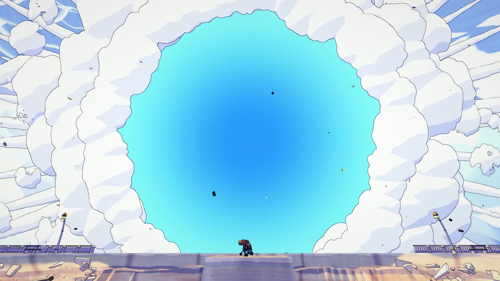
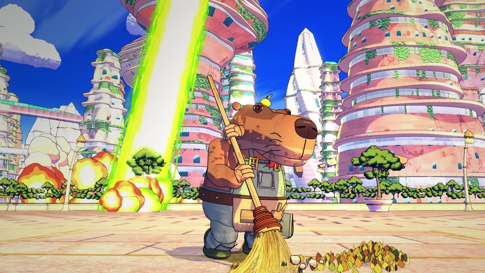
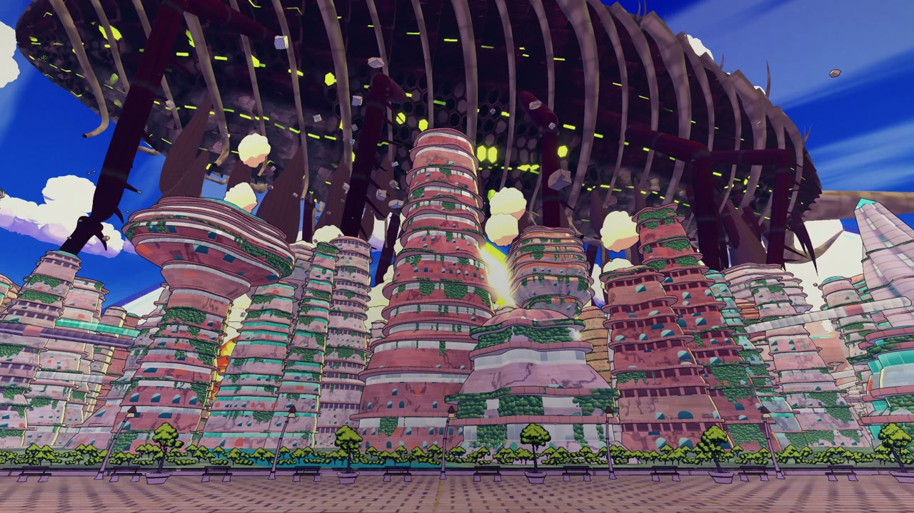
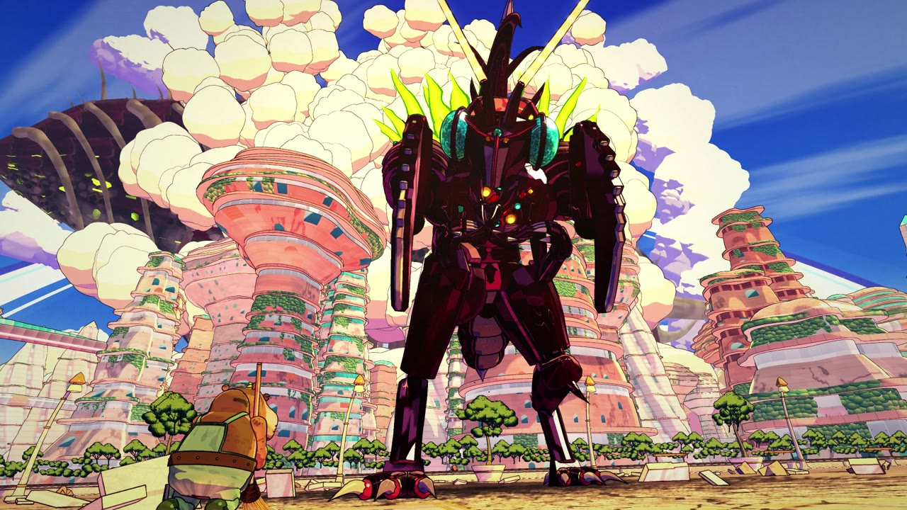
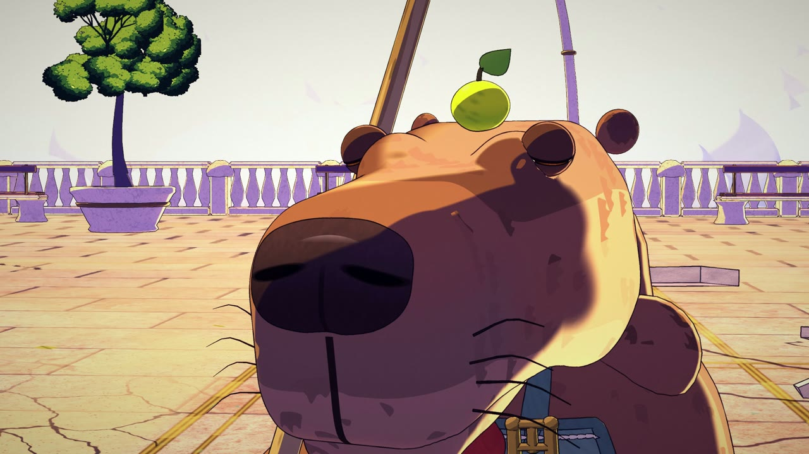
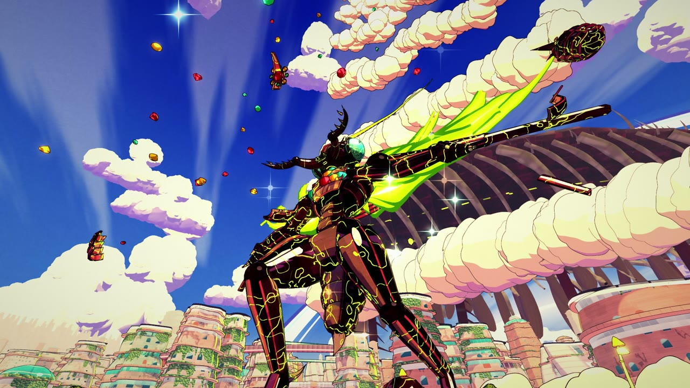

# ONE SWEEP · 一掃

A 78-second anime short where every frame is made by code: no video model, no image model, no hand-drawn frames.
A calm capybara janitor sweeps one small pile of leaves on a shining city built on a ring around a planet, while a beam
cuts the district behind him in half and he does not notice. A 7 km hive ship arrives. An insect warlord lands, boasts,
sheds its armour and throws bigger and bigger attacks at him. Then the wind takes his pile, and for the first time in
the film he looks up. One sweep of the broom, and the clouds open around the whole planet.

The scene is a shot-for-shot retelling of a famous anime fight: the same actions, staging and timing, with every visual
(city, characters, ship, colours) designed from scratch.



| | |
|---|---|
|  |  |
|  |  |
|  |  |

**Watch:** [film/one-sweep.mp4](film/one-sweep.mp4) (1920×1080, 24 fps, 78.2 s; click "View raw" to download).

Made with Claude Opus 5.5 in Claude Code.

---

## How it looks like anime

three.js (WebGL2) builds the whole world in the browser and a chain of full-screen passes draws every frame the way a
cel + painted-background production would:

| Pass | What it does |
|---|---|
| shadow | one sun shadow map with hard cel edges |
| main (MRT) | colour with cel light, plus depth, object id, material id and normals |
| paint | Kuwahara gouache brush on the backgrounds only |
| ink | lines from object-id, depth and normal edges, only where a material asks for ink; thinner far away |
| atmosphere | haze and dust |
| overlay / bloom / final | energy, sparks and flashes drawn as inked 2D-style shapes; bloom; film grade with split toning |

* **Everything is 3D under the drawing.** A city of white coral towers on a ring around a planet, hanging gardens, an
  esplanade that becomes a crater, a sea of clouds, a 7 km hive ship with ribs like a whale skeleton, an insect warlord in
  wine-coloured armour, and a capybara in overalls with a straw broom and a small citrus on his head.
* **Every shot has its own light rig** in `src/colorscript.js`: key, rim, bounce and one energy light with a visible source.
* **Animation is on twos**, like film anime; bodies keep their centre of mass over their feet, anticipate, overshoot and settle.
* **One map and one clock.** `src/layout.js` is the shared map and `src/shots.js` holds the story cues and the 31 shots;
  every department places and times things from those numbers, so the world stays continuous across cuts.
* **Checked before rendering.** `tools/qa.mjs` tests the frames on the real geometry with BVH trees (no hand, foot or body
  inside the ground, props or another body; the camera never inside a mesh or under the ground), `tools/feet.mjs` catches
  sliding feet, `tools/smooth.mjs` flags camera jerks and `tools/pops.mjs` flags anything that appears or vanishes mid-shot.
* **The score uses real orchestral samples** (see [audio/CREDITS.md](audio/CREDITS.md)) plus designed SFX, all mixed from
  code in `audio/render.py`, with the hits read from the film and landed on picture ([audio/NOTES.md](audio/NOTES.md)).

## How it was made

One director session and parallel agent teams in Claude Code, working from a shared contract
([CONTRACT.md](CONTRACT.md)): city, sky, warlord, capybara, FX, sound. Each team owned its own files and cameras and
rendered stills to check its work before the final render.

## Run it

Requirements: Node 18+, Google Chrome (set `CHROME` if it is not in the default place), `ffmpeg` on `PATH`, and
Python 3.11+ with `numpy`, `scipy` and `soundfile` for the score.

```bash
npm install
npx http-server . -p 8080        # or any static server; open http://localhost:8080 for the scrubbable workbench
node tools/check.mjs             # load check
node tools/qa.mjs --step 2       # BVH checks on every second frame
node tools/snap.mjs t:47 --scale 0.5
```

Build the score (downloads the CC0 samples once, see [audio/README.md](audio/README.md)):

```bash
python -I audio/tools/fetch_samples.py
python -I audio/tools/build_index.py
node audio/tools/dump_cues.mjs
python -I audio/render.py
```

Render all 1,877 frames and mux the film with `out/soundtrack.wav`:

```bash
node tools/render.mjs --scale 2 --name one-sweep
```

## Layout

```
CONTRACT.md         the production contract: shot list, designs, map, file ownership, APIs, QA rules
index.html          the workbench (scrub / play) and the headless render page
src/engine.js       the render passes; look.js the grade presets; colorscript.js the light of every shot
src/layout.js       the shared map; shots.js the cues and the 31 shots
src/ring*.js        the ring city and the crater       src/heavens-*.js  sky, orbit, clouds and the hive ship
src/capy*.js        the capybara                       src/warlord*.js   the warlord, its armour and mantle
src/fx*.js          beams, slashes, impacts, dust, the finale
src/cams/*.js       each department's cameras and looks for its shots
tools/              check, snap, sheet, qa, feet, smooth, pops, render
audio/              the score, its sample engine, SFX, cue sheet and credits
vendor/             three.js r170, three-mesh-bvh, addons
```

## Credits and license

MIT. The render engine and some modelling and FX code are adapted from the Leviathan project (MIT,
[vendor/LEVIATHAN-LICENSE](vendor/LEVIATHAN-LICENSE)). three.js and three-mesh-bvh are MIT. The orchestral samples are
CC0 ([audio/CREDITS.md](audio/CREDITS.md)); they are downloaded by the fetch script, not stored here.
